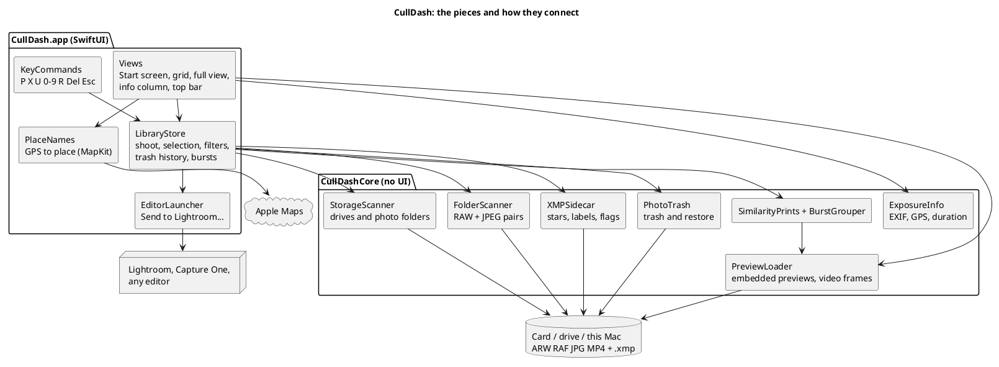
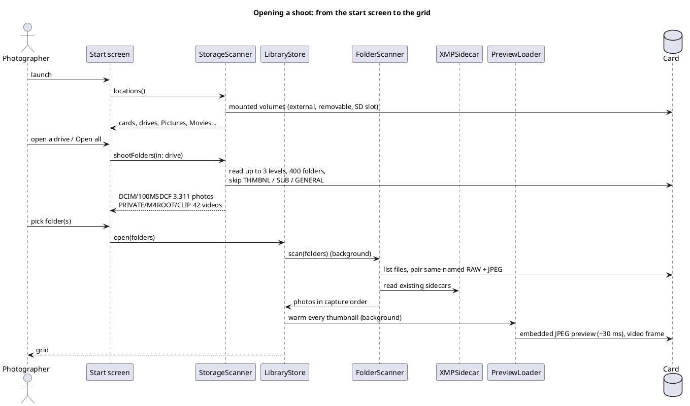
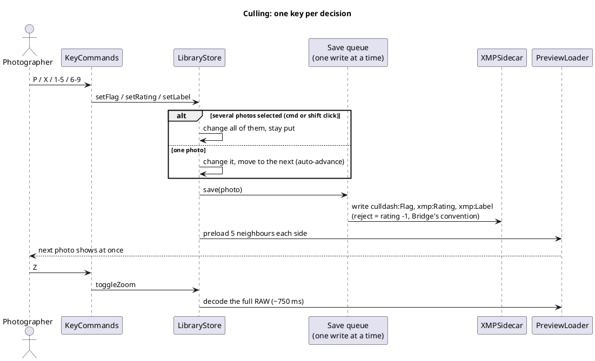
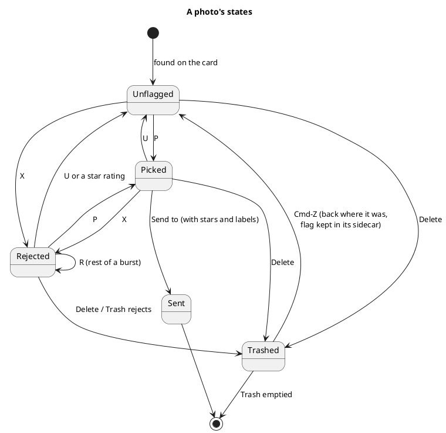
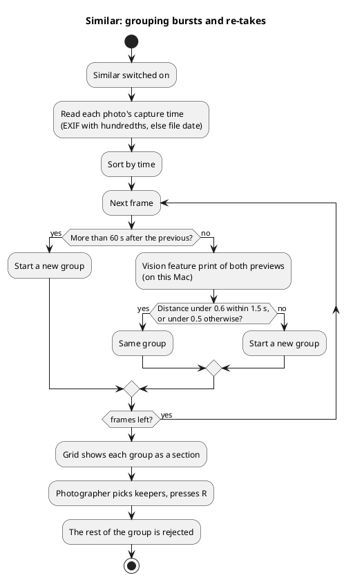
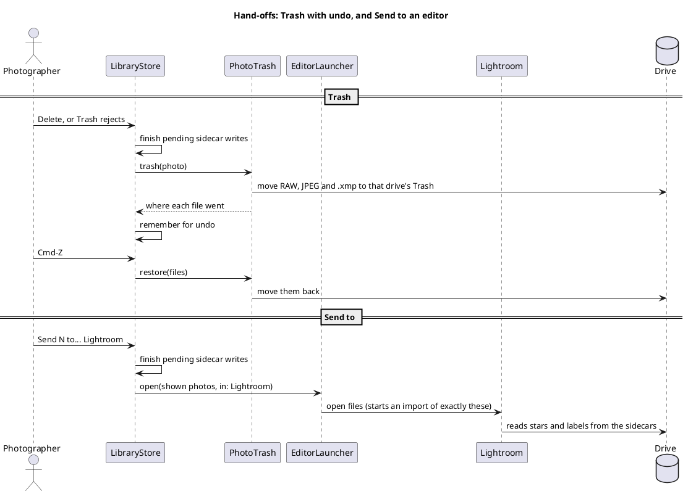

# How CullDash works

CullDash is a native Mac app for culling photo and video shoots: open a card,
flick through every frame, keep the best, trash the rest, and send the keepers
to an editor. This document explains what each part does and how the main
flows run. The diagrams are drawn in PlantUML (`docs/diagrams/*.puml`) and
rendered with `scripts/diagrams.py`.

## The pieces

The app has two Swift modules and a website:

- **CullDashCore** does everything that touches files and has no UI, so it can
  be tested on its own: listing drives and photo folders (`StorageScanner`),
  pairing RAW and JPEG files (`FolderScanner`), fast previews from the JPEG a
  camera embeds in each RAW and frames from video clips (`PreviewLoader`),
  EXIF, GPS and clip length (`ExposureInfo`), XMP sidecars (`XMPSidecar`),
  grouping similar shots (`SimilarityPrints`, `BurstGrouper`) and the Trash
  with undo (`PhotoTrash`).
- **CullDash** is the SwiftUI app. `LibraryStore` holds the open shoot, the
  selection, filters, the trash history and burst groups; the views draw it;
  `KeyCommands` turns keys into decisions; `EditorLauncher` hands photos to
  Lightroom or another editor; `PlaceNames` turns GPS into a place name.
- **site/** is the Next.js landing page. It does not talk to the app.

<!-- diagram:architecture -->

PlantUML source

<!-- /diagram -->

## Opening a shoot

The start screen lists cards (including the Mac's own SD slot), drives and
folders on this Mac. Opening a drive searches at most three levels and 400
folders, so even a large archive drive answers in seconds, and skips camera
housekeeping folders. A folder, or every folder on a card at once, is then
scanned in the background and its thumbnails are warmed so the grid never waits.

<!-- diagram:open-shoot -->

PlantUML source

<!-- /diagram -->

## Culling

Every decision is one key. A flag or rating moves to the next photo by itself;
with several photos selected it applies to all of them. Each change is saved to
the photo's XMP sidecar through a queue that writes one file at a time, so two
quick presses can never land out of order. Neighbouring previews load ahead in
both directions; Z decodes the full RAW for a focus check.

<!-- diagram:cull-loop -->

PlantUML source

<!-- /diagram -->

## A photo's states

<!-- diagram:photo-states -->

PlantUML source

<!-- /diagram -->

## Similar shots

Grouping uses capture time and Apple's on-device Vision feature prints. The
thresholds were measured on real Sony a6400 portraits: re-takes of one pose were
0.21 to 0.49 apart, different set-ups 0.56 and more.

<!-- diagram:similar -->

PlantUML source

<!-- /diagram -->

## Trash and Send to

Files only ever go to the Trash on their own drive, with their JPEG and sidecar,
and ⌘Z moves them back. Sending opens exactly the photos shown in the chosen
editor after all sidecars are written, so stars and labels arrive with them.
Lightroom does not read picks from other apps, so keepers should carry a star or
a label.

<!-- diagram:handoffs -->

PlantUML source

<!-- /diagram -->
