# How CullDash works

CullDash is a native Mac app for culling photo and video shoots: open a card,
flick through every frame, keep the best, trash the rest, and send the keepers
to an editor. This document explains what each part does and how the main
flows run. The diagrams are drawn in PlantUML (`docs/diagrams/*.puml`) and
rendered with `scripts/diagrams.py`.

## The pieces

The app has two Swift modules and a website:

- **CullDashCore** does everything that touches files and has no UI, so it can
  be tested on its own: listing drives and photo folders (`StorageScanner`),
  pairing RAW and JPEG files (`FolderScanner`), fast previews from the JPEG a
  camera embeds in each RAW and frames from video clips (`PreviewLoader`),
  EXIF, GPS and clip length (`ExposureInfo`), XMP sidecars (`XMPSidecar`),
  grouping similar shots (`SimilarityPrints`, `BurstGrouper`) and the Trash
  with undo (`PhotoTrash`).
- **CullDash** is the SwiftUI app. `LibraryStore` holds the open shoot, the
  selection, filters, the trash history and burst groups; the views draw it;
  `KeyCommands` turns keys into decisions; `EditorLauncher` hands photos to
  Lightroom or another editor; `PlaceNames` turns GPS into a place name.
- **site/** is the Next.js landing page. It does not talk to the app.

<!-- diagram:architecture -->
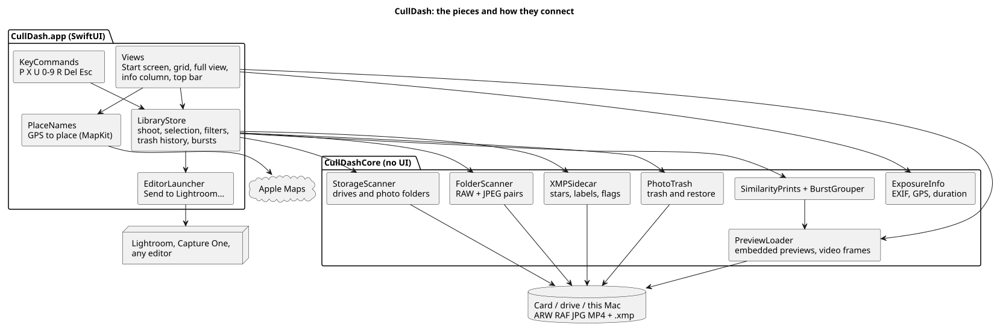

PlantUML source

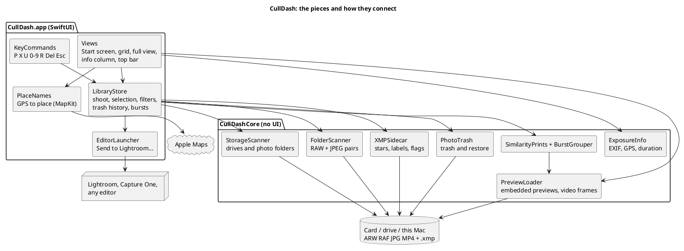

<!-- /diagram -->

## Opening a shoot

The start screen lists cards (including the Mac's own SD slot), drives and
folders on this Mac. Opening a drive searches at most three levels and 400
folders, and skips camera housekeeping folders. A folder, or every folder on a
card at once, is then scanned in the background and its thumbnails are warmed
so the grid never waits.

Every folder is read through `DirectoryListing`, which asks the file system for
names, kinds and modification dates together, in batches, with
`getattrlistbulk`. `FileManager.contentsOfDirectory` fetches attributes one
file at a time, and on an external drive that is a seek each: a 5,352-file card
folder on a USB hard drive took 54 seconds to list that way, cold, against
33 milliseconds in bulk. Opening a whole 8,240-photo drive went from 175
seconds to under half a second on the same hardware. The same listing also
tells `FolderScanner` which photos have an XMP sidecar, so it opens only those
rather than probing for a file beside every frame.

<!-- diagram:open-shoot -->
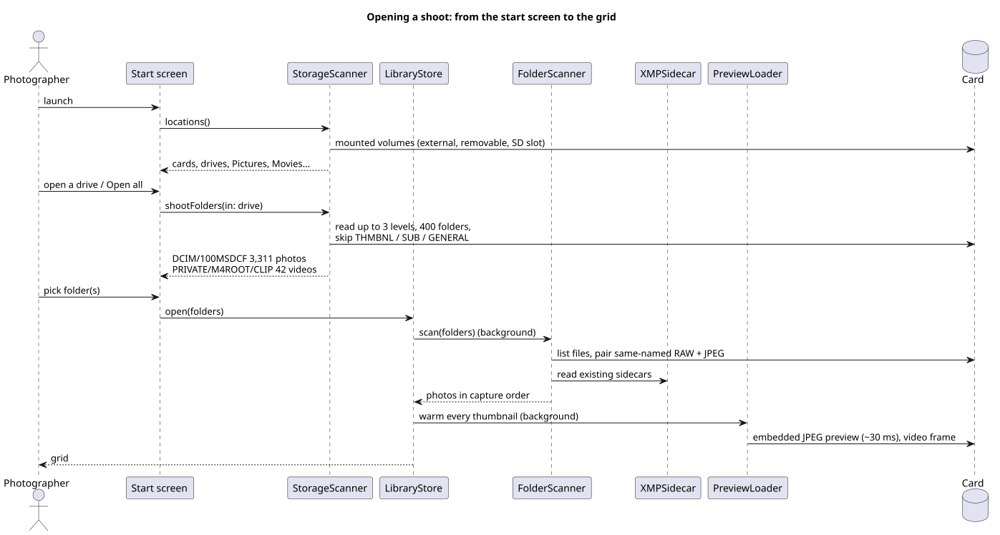

PlantUML source

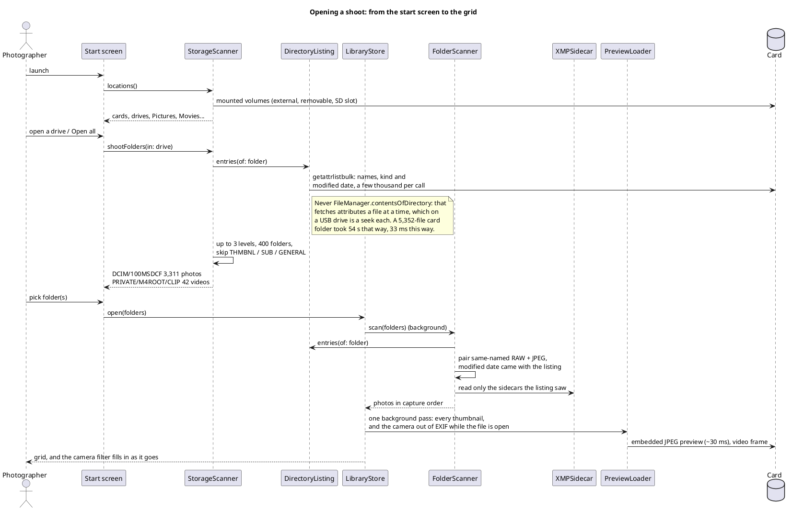

<!-- /diagram -->

## Culling

Every decision is one key. A flag or rating moves to the next photo by itself;
with several photos selected it applies to all of them. Each change is saved to
the photo's XMP sidecar through a queue that writes one file at a time, so two
quick presses can never land out of order. Neighbouring previews load ahead in
both directions; Z decodes the full RAW for a focus check.

The flag segments, the star rating, the file kinds, the cameras and the name
search all narrow the same list, so they combine: 3-stars-and-up RAW frames
from one body is a single view. Ticking more than one choice inside a group
widens that group instead — two cameras shows photos from either. The Filters
button carries a count of the groups in play, and clears them all in one go.
Cameras come from EXIF, which means opening each file, so they are collected by
the background pass that is already loading thumbnails rather than by a pass of
their own: a separate pass over an 8,240-photo drive took over two minutes even
spread across every core, because it is a seek per file. The menu shows how far
that reading has got while it runs.

<!-- diagram:cull-loop -->
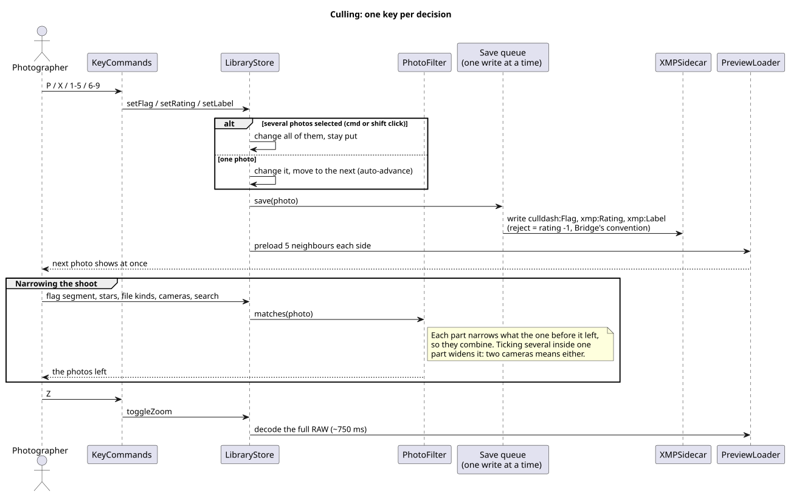

PlantUML source

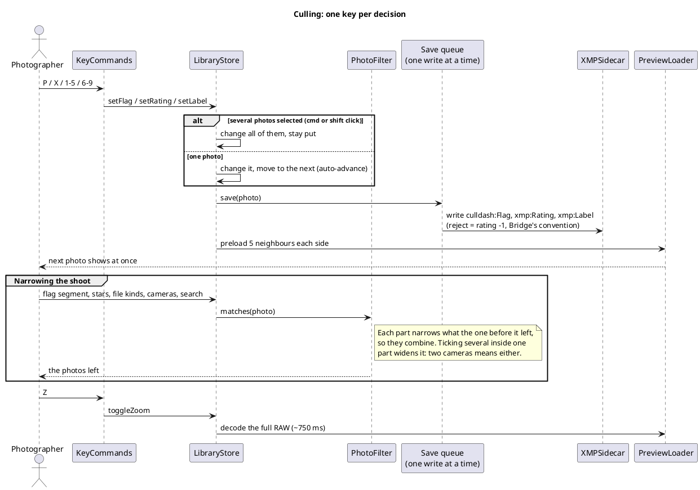

<!-- /diagram -->

## Looking closely

Z, or a double-click, decodes the RAW whole and shows it pixel for pixel. From
there a mouse wheel zooms around the pointer, a pinch zooms, a two-finger
trackpad scroll pans, and dragging moves the photo under the pointer; the
photo goes from fitting the window to eight times its own pixels, drawn
unsmoothed above 100% so grain and focus read true. Once there is more photo
than fits, a minimap appears in the corner with a box around the part on
screen, and clicking or dragging inside it jumps there.

<!-- diagram:zoom -->
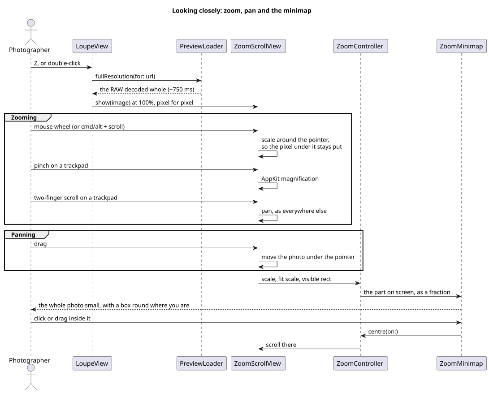

PlantUML source

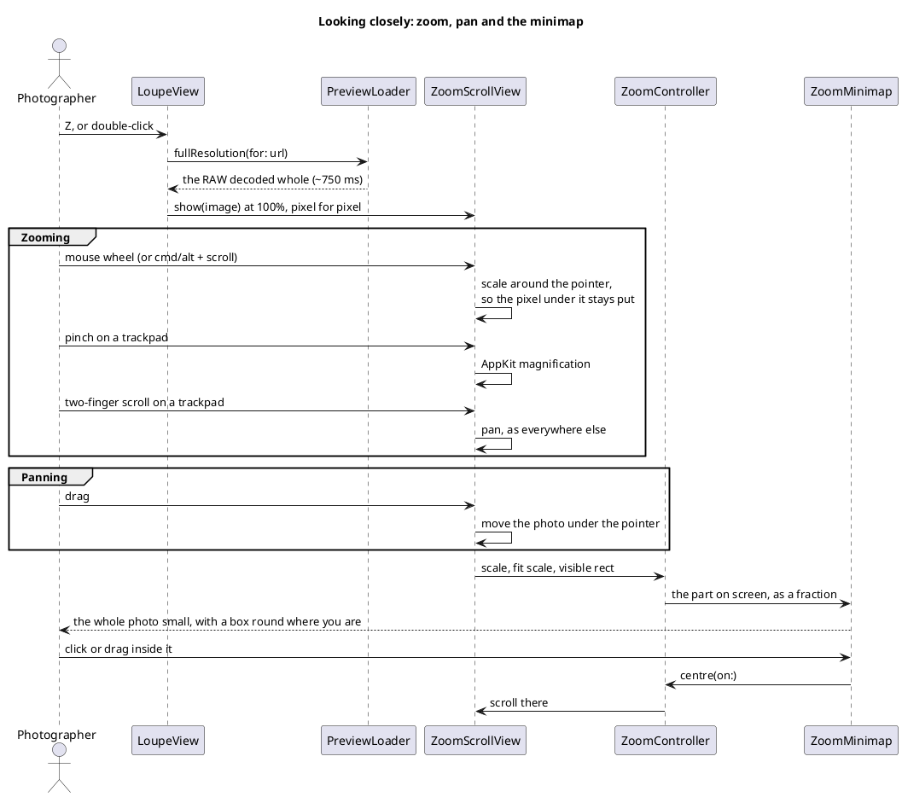

<!-- /diagram -->

## Trimming a clip

A video opened full screen plays like any other clip: Space plays and pauses it
rather than leaving the view, and Return still goes back to the grid. Space
reaches the player through a counter on the store, because the player belongs
to the view while the keys are read from the window.

Editing starts with the pencil button under the clip, which brings out a row of
pieces; until then the row stays out of the way, since most clips are only
watched.

`ClipEdit` holds the clip as the pieces that are **kept**, not the parts cut
away, so a hole is not a thing it can represent: dropping a piece shortens the
row and everything after it slides left. That makes two kinds of position, and
the names say which is which. A *source* time is a moment in the original file;
an *output* time is a moment in what is left, which is what the row draws and
the playhead runs along. `locate(output:)` turns one into the other.

Splitting divides the piece under the playhead in two, which changes nothing
about the result — the row still adds up to the whole clip — so saving stays
unavailable until a piece is dropped. Dropping one removes it; what remains is
already flush, because the pieces are simply concatenated.

Leaving the clip silences it. Stepping to a photo, going back to the grid or
trashing the clip mid-play all take the view away, and a player nobody can see
carries on playing: the periodic time observer keeps it alive, so the sound of
a clip that is no longer on screen, or has just gone to the Trash, goes on. The
view therefore pauses, drops its item and removes that observer as it goes.

The player is handed an `AVComposition` of the pieces rather than the file, so
it plays the edit back and its clock runs in output time. Without that the
playhead would be measuring the original while the row measured the result, and
the two would drift apart the moment anything was cut.

Saving writes the pieces end to end through `AVAssetExportPresetPassthrough`,
which copies the streams rather than re-encoding them: a 4K clip is written
about as fast as it can be read and comes out identical to the source. The cost
is that each cut lands on the keyframe before the mark, which on long-GOP
footage can be a second early — the same trade QuickTime makes. The result goes
beside the original as `<name>-trimmed.MOV`, or takes the original's place, in
which case the original goes to that drive's Trash and joins the undo history,
so ⌘Z brings the full-length clip back.

Either way the shoot is told about it. A new clip is inserted beside the one it
came from, carrying that clip's capture date and its decisions, so it sorts in
next to its source and arrives already flagged and rated the same; the
selection does not move. Without that the file would exist only on the card
until the folder was opened again.

<!-- diagram:trim-clip -->
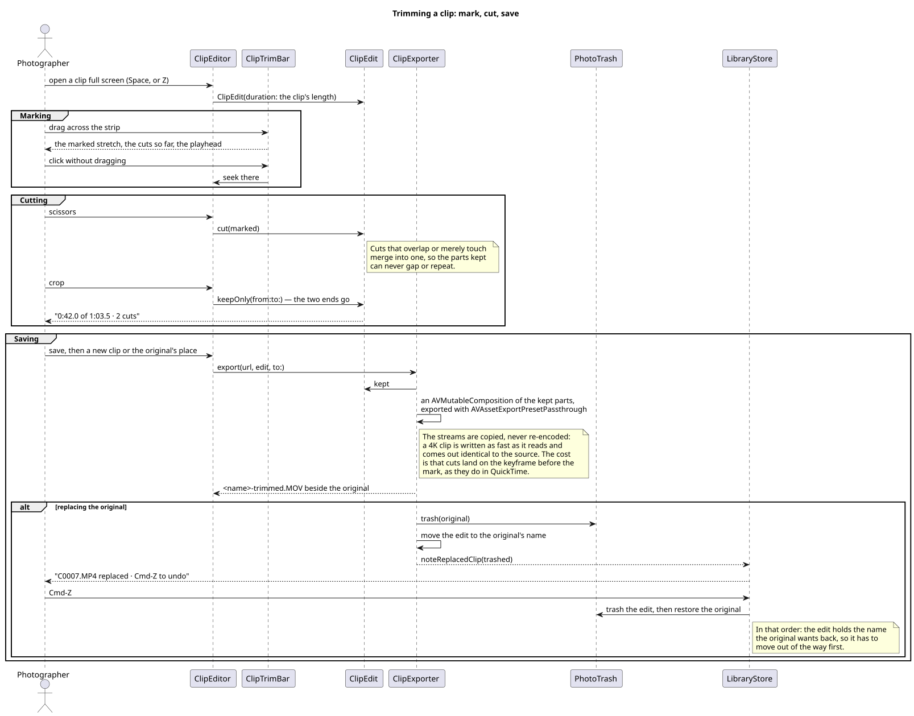

PlantUML source

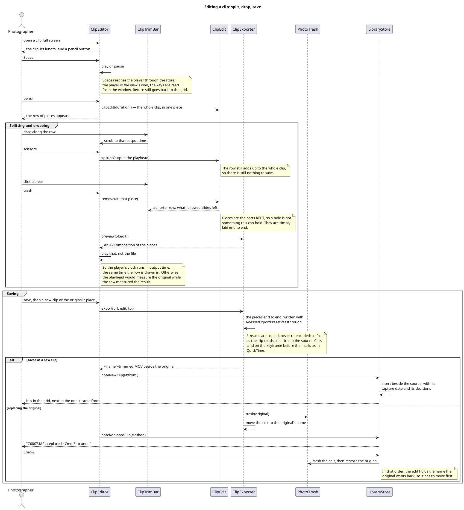

<!-- /diagram -->

## A photo's states

<!-- diagram:photo-states -->
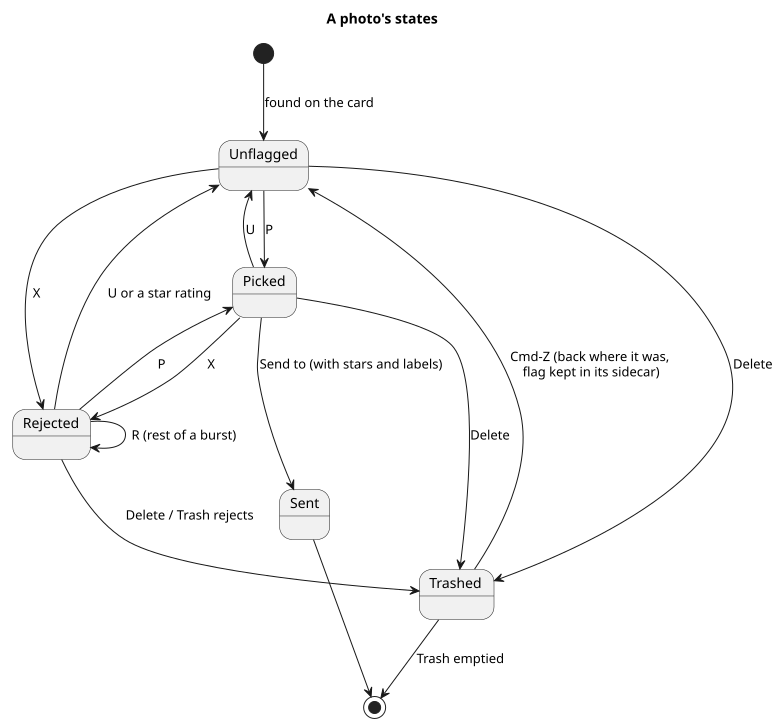

PlantUML source

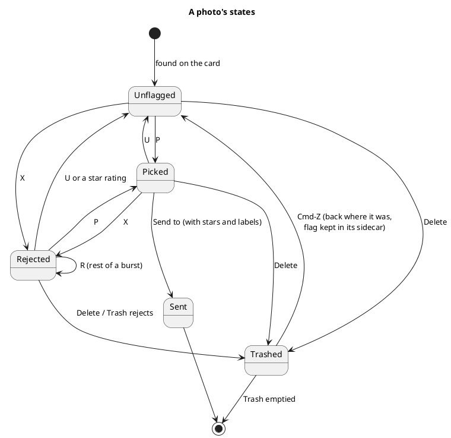

<!-- /diagram -->

## Similar shots

Grouping uses capture time and Apple's on-device Vision feature prints. The
thresholds were measured on real Sony a6400 portraits: re-takes of one pose were
0.21 to 0.49 apart, different set-ups 0.56 and more.

<!-- diagram:similar -->
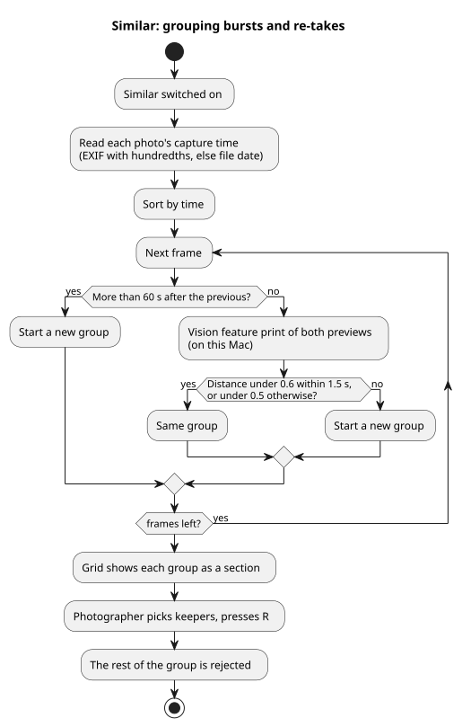

PlantUML source

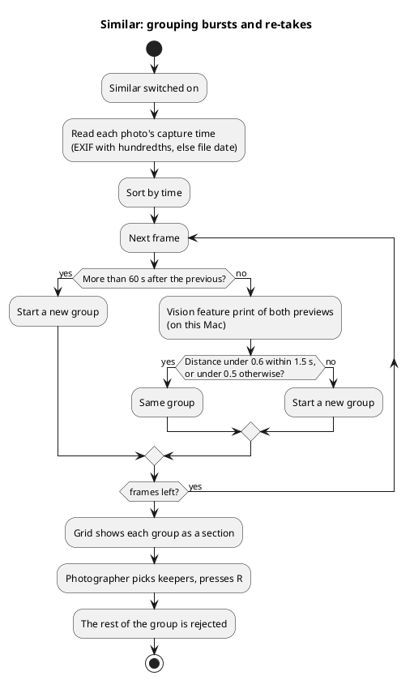

<!-- /diagram -->

## Trash and Send to

Files only ever go to the Trash on their own drive, with their JPEG and sidecar,
and ⌘Z moves them back. Sending opens exactly the photos shown in the chosen
editor after all sidecars are written, so stars and labels arrive with them.
Lightroom does not read picks from other apps, so keepers should carry a star or
a label.

<!-- diagram:handoffs -->
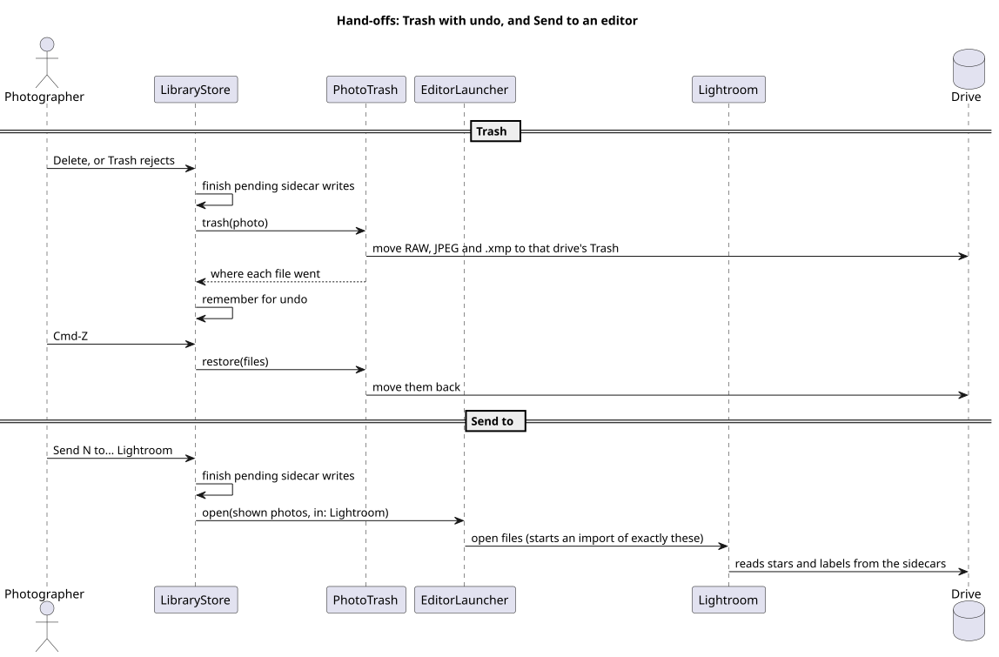

PlantUML source

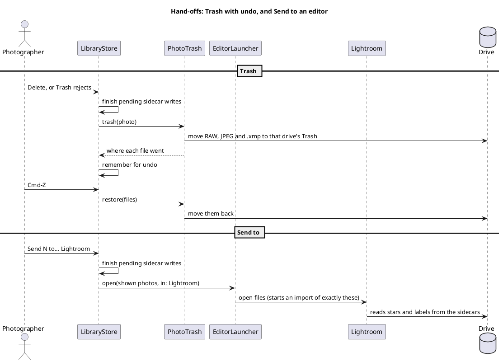

<!-- /diagram -->
